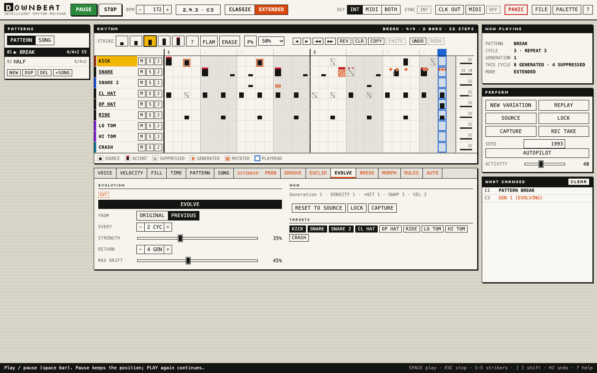

# DOWNBEAT

**An intelligent rhythm machine.** You establish a rhythm; DOWNBEAT explores
what that rhythm could become.

DOWNBEAT is a browser instrument for drums and percussion. Write a pattern,
press PLAY, and keep intervening: thin it out, fill the gaps, shift it, let
it evolve, breed it with another pattern, morph between two, or leave the
autopilot running. What you wrote is never changed by the performance: the
grid always shows which hits are yours, which were **generated**, which were
**suppressed** this time round, and where each voice is playing.

It plays immediately through its own synthesised drum sounds, and it is a
full MIDI instrument: per-voice channels and notes, 24 PPQN clock in and out
with Start / Stop / Continue, Standard MIDI File export and import. It is
meant to sit beside external drum machines, samplers and modular systems
(a Hermod+, for example).



**Live:** <https://downbeat.allmyfriendsaresynths.com> (deployed with GitHub Pages from `main`) ·
**Quick Start:** [docs/QUICK_START.md](docs/QUICK_START.md)

## Inspiration

DOWNBEAT is inspired by **UpBeat**, "the intelligent rhythm programmer"
published for the Apple Macintosh by Intelligent Music in 1987 (created by
John Offenhartz) and updated as UpBeat 2.0 in 1990. UpBeat treated each
drum track's playback as something the program could vary: note density,
timing, velocity ranges, automatic fills, loops of their own length. DOWNBEAT
is an independent, clean-room instrument built from what the contemporary
reviews document, with modern generative extensions.

DOWNBEAT is not affiliated with or endorsed by Intelligent Music, its
successors or the original developers. It contains none of their code,
artwork, samples or presets; no original software or manual was available
during development. See [docs/HISTORICAL_RESEARCH.md](docs/HISTORICAL_RESEARCH.md)
and [docs/SOURCES.md](docs/SOURCES.md).

It joins a family of instruments: **emmm** (Intelligent Music's M),
**Feelers** (Dr. T's Fingers), **FrakMC** (Fractal Music Composer),
**ANVIL** (Dr. T's Tunesmith) and **Good Bits**.

## CLASSIC and EXTENDED

| | What it is |
| --- | --- |
| **CLASSIC** | UpBeat's documented behaviour, independently implemented: five velocity strikers and a random striker with centre ± range, sound step lists with random steps (sound variation), flams, note density, ± timing and track shift, automatic fills (fill sound, amount, rate, spacing, notes per gap, fill velocity), per-track loop points with loop percentages (polyrhythm), the Jam roll, patterns, songs, MIDI files. Where the sources stop, DOWNBEAT's approximations are labelled INFERRED and versioned. See [docs/CLASSIC_SPEC.md](docs/CLASSIC_SPEC.md). |
| **EXTENDED** | New: per-voice and per-step probability, extra hits, groove and swing, a Euclidean generator, evolution (from the original, or from the previous variation), mutation, breeding, morphing, WHEN / THEN rules and an autopilot with one ACTIVITY control. Every feature can be switched off; CLASSIC switches them all off. See [docs/EXTENDED_SPEC.md](docs/EXTENDED_SPEC.md). |

Both modes share one engine, one scheduler and one MIDI system. Every random
decision is a keyed hash of a seed, so the same project and seed replay the
same take; NEW VARIATION changes the seed, LOCK repeats the variation you
hear, SOURCE plays only what you wrote, CAPTURE writes what you hear into a
new pattern.

## Samples, processing and audio export

The **AUDIO** button opens three windows:

- **SAMPLE BANK**: every drum sound (each sound step of each voice) plays its voice's internal
  sound or a **sample** you load or drop in: volume, pan, tuning, one-shot / gated / loop,
  **choke groups** (a closed hat cutting an open hat; AUTO keeps DOWNBEAT's original hat choke)
  and **sample transformations** (Good Bits stretch, varispeed, reverse, drive, crunch).
- **PROCESSING**: Good Bits output processing per voice and on the master (output stages,
  drive, crunch, tone), before VOLUME and DOWNBEAT's master compressor.
- **OUTPUT CHAIN**: a chain of Slop Factory Core output engines on the master, after master
  processing and before VOLUME (the same engines The Good Bits, The Breakery and emmm use): add,
  reorder, bypass and configure them; live and in the exported master, never in stems or MIDI.
- **EXPORT AUDIO**: a pattern, the song or a recorded take as WAV (44.1 kHz, 16-bit): the master,
  **stems per sequencer voice**, **stems per drum sound**, or all of them in one ZIP. Every file
  is sample-aligned and the same length.

Samples stay in the browser (IndexedDB); **FILE → DOWNLOAD BUNDLE** carries a project with its
samples to another browser. Old projects open unchanged and sound as before. All of this is
**[Slop Factory Core](https://github.com/clickysteve/slopfactory-core)**, the audio package
DOWNBEAT shares with ANVIL. Details: [docs/AUDIO.md](docs/AUDIO.md).

## Demos

Six original demos (FILE → DEMOS): Basic Electro, Four to the Floor,
Broken Beat, Jungle Pressure, Minimal Generative, Polymetric Percussion.

## Running it

```bash
npm ci
```

This installs the pinned version of Slop Factory Core from its git tag (see `package.json` and
`package-lock.json`); nothing else is needed and nothing is fetched at run time.

```bash
npm run dev
```

Then open the address Vite prints. Other scripts:

| Command | |
| --- | --- |
| `npm test` | unit tests (Vitest): engine, MIDI and transport, persistence, palettes, audio settings, event adapter, export planning |
| `npm run typecheck` | TypeScript |
| `npm run build` | production build in `dist/` (relative paths: works at any address) |
| `npm run test:e2e` | browser tests (Playwright) against the built site, using the installed Google Chrome locally (or `DOWNBEAT_CHROMIUM=/path/to/chromium`): the instrument, the audio windows with real WAV/ZIP downloads, and measured audio verification |

Web MIDI needs Chrome, Edge, Opera or Firefox. Internal sounds work in any
modern browser; output processing needs AudioWorklet (https or localhost). Audio export is
tested in Chromium.

## Documentation

- [Quick Start](docs/QUICK_START.md)
- [Historical research](docs/HISTORICAL_RESEARCH.md), [Classic spec](docs/CLASSIC_SPEC.md), [Uncertainties](docs/UNCERTAINTIES.md), [Sources](docs/SOURCES.md)
- [Extended spec](docs/EXTENDED_SPEC.md)
- [Samples, processing and audio export](docs/AUDIO.md), [Audio verification](docs/AUDIO-VERIFICATION.md)
- [Architecture](docs/ARCHITECTURE.md), [Design](docs/DESIGN.md), [MIDI and sync](docs/MIDI.md)

## How historical is CLASSIC?

No UpBeat manual or executable could be found. CLASSIC is built from three
contemporary magazine reviews (1987 and 1990), adverts and screenshots, not
from observing the original program. The reviews describe *what* UpBeat's
controls did, rarely *how*: the exact density, fill, jam and flam algorithms
are DOWNBEAT's own approximations, labelled INFERRED and versioned so they can
be corrected later without changing saved projects. CLASSIC is a faithful
reading of the documented feature set, not an exact reproduction of UpBeat's
output.

## Known limitations

- Songs are flat lists of patterns with repeat counts (UpBeat could nest songs).
- Patterns are at most 8 bars and 64 steps; a track's loop cannot be longer than its pattern.
- Not implemented from UpBeat: paste modes and the Compander, articulation strikers, program-change strikes, MIDI Volume, count-in, MIDI Thru, Normal (synth) tracks, MIDI files inside songs. See [docs/UNCERTAINTIES.md](docs/UNCERTAINTIES.md).
- The fill ZONE control is an EXTENDED addition that stays available in CLASSIC (set it to ANYWHERE for the documented behaviour).
- No physical MIDI hardware has been tested: MIDI was verified with simulated Web MIDI devices only. See [docs/MIDI.md](docs/MIDI.md) for what needs checking on real equipment.
- The internal sounds were checked in code and in the browser, not by ear in automated tests.
- Audio: one sample per drum sound (no layers or zones); processing is per voice and master,
  not per drum sound; drum-sound stems leave out voice processing (it cannot be split exactly by
  sound); external MIDI instruments are not rendered; exports up to 20 minutes; tested in
  Chromium only. See [docs/AUDIO.md](docs/AUDIO.md).

## Licence

MIT (see [LICENSE](LICENSE)) for DOWNBEAT's own code. "UpBeat" and
"Intelligent Music" are named only to describe the historical inspiration.
