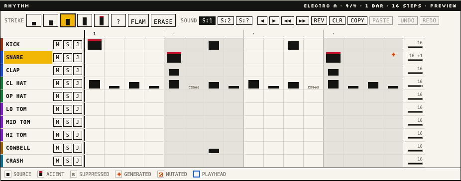
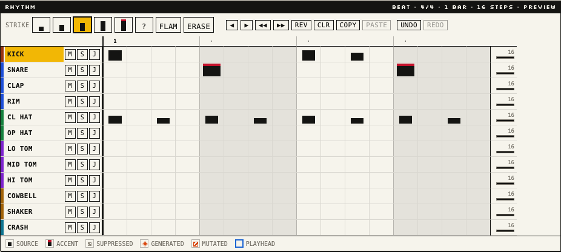
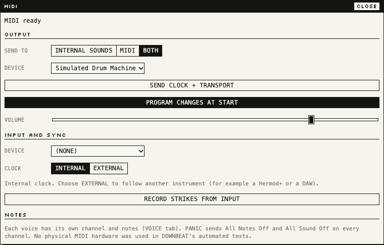

# DOWNBEAT Quick Start

Two minutes from nothing to a rhythm that plays itself differently every
time round. You need a browser and speakers; MIDI equipment is optional.

## 1. Press PLAY (10 seconds)

Open DOWNBEAT. The first time, it loads the **Basic Electro** demo. Press
**PLAY** (or the space bar). You hear the built-in drum sounds.

Watch the grid while it plays:

- **Solid bars** are the strikes written in the pattern. Taller is louder;
  accents carry a red cap.
- **Hollow, struck-through bars** are written strikes that are *resting*
  this cycle (the hats are at 88 % density).
- **Orange diamonds** are **generated** notes: fills that DOWNBEAT adds in
  the gaps. They change every time round and are never written into your
  pattern.
- The **blue column** is the step playing now.

## 2. Change what it does with your rhythm (30 seconds)

Click **CL HAT** (the voice name) to select it, open the **TIME** tab and
drag **DENSITY** down to 40 %. More hats rest, but a different subset each
cycle; the louder ones survive more often. Drag it back: nothing was lost.

Click **SNARE**, open **FILL**: raise **AMOUNT**, set **RATE** to 2 or 3 for
rolls, choose **SOUND: LO TOM** so the toms play the snare's fills. Fills
lead into the next written snare.

Hold **J** on a voice row to jam a roll on it while you hold it.

## 3. Write your own (30 seconds)

**FILE → NEW PROJECT** gives a plain beat. Choose a striker in the strip
above the grid (keys **1-5**; **5** is the accent, **0** is the random
striker) and click or drag across cells. Click a strike again to remove it;
right-click erases; Alt-click adds a flam. **◀ ▶** shift the selected voice
round by a step; **[ ]** do the same from the keyboard. **UNDO** is
Cmd/Ctrl-Z.

## 4. Let it explore (40 seconds)

Switch the top bar from **CLASSIC** to **EXTENDED**. New tabs appear.

- **EVOLVE**: switch **EVOLVE** on. Every couple of cycles a new
  *generation* plays: hatched bars are hits the variation added, outlined
  ones it changed. **ORIGINAL** always mutates your pattern afresh;
  **PREVIOUS** keeps building on the last variation (MAX DRIFT pulls it
  back). **LOCK** keeps a generation you like; **RESET TO SOURCE** returns.
- **AUTO** (or the **AUTOPILOT** button on the right): leave it running.
  It moves between sections (HOME, VARY, BUSY, SPARSE, BREAK), fills at the
  end of every phrase and keeps coming home. **ACTIVITY** sets how far it
  goes.
- Try the **JUNGLE PRESSURE** demo (FILE → DEMOS) for triplet snare rolls
  and an evolving break, or **POLYMETRIC PERCUSSION** for voices looping at
  15, 7, 5, 12 and 9 steps against 16: each row shows its own playhead.

The **WHAT CHANGED** panel lists every fill, generation, rule and section
as you hear it.

**FOLLOW** (above the grid, on by default): the grid shows whichever pattern
the song is playing and scrolls to keep the playhead in view. Click a
pattern while a song plays and FOLLOW switches off, so you can edit that
pattern while the song carries on; click FOLLOW to follow the song again.

## 5. Keep, compare, replay

| Button | Does |
| --- | --- |
| **NEW VARIATION** | a new seed: every random decision changes |
| **REPLAY** | from the top with the same seed: the identical take |
| **SOURCE** | A/B: only what you wrote, nothing generated or resting |
| **LOCK** | every cycle repeats the variation you are hearing |
| **CAPTURE** | write what you hear into a new pattern (generated notes on grid steps included; notes between steps cannot be strikes and are left out) |
| **REC TAKE** | record everything that plays, for MIDI export |

Your work autosaves in the browser. **FILE** saves named projects, exports
`.downbeat.json` files and MIDI files (the written pattern, the performance,
the song or a recorded take), and imports both.

## 6. Play external instruments

Press **MIDI**, then **ENABLE MIDI**, choose the device, and set **SEND TO**
to MIDI or BOTH. Each voice has its own channel and note: the **DRUM MAP**
in the same dialog lists every voice, so you can type the notes your drum
machine or Hermod+ expects (`36` or `C1`), nudge them with − / +, or press
**LEARN** and hit a pad. Defaults are General MIDI drums on channel 10. **CLK OUT** sends 24 PPQN
clock with Start / Stop / Continue. To follow another instrument instead,
choose its input and **CLOCK: EXTERNAL**.

More: [MIDI.md](MIDI.md) · what is historical and what is new:
[CLASSIC_SPEC.md](CLASSIC_SPEC.md), [EXTENDED_SPEC.md](EXTENDED_SPEC.md).
